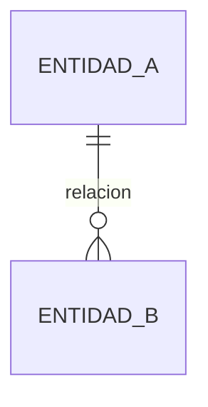

# Modelo conceptual de datos (C1-A)

## Entidades

| TB | Entidad | Descripción | Paso P que la justifica | Sistema oficial | Volumen a 3 años | Datos sensibles |
| --- | --- | --- | --- | --- | --- | --- |
| | | | | | | |

## Diagrama ER

Actualizar este diagrama cada vez que cambie el modelo. Se puede revisar en https://mermaid.live

